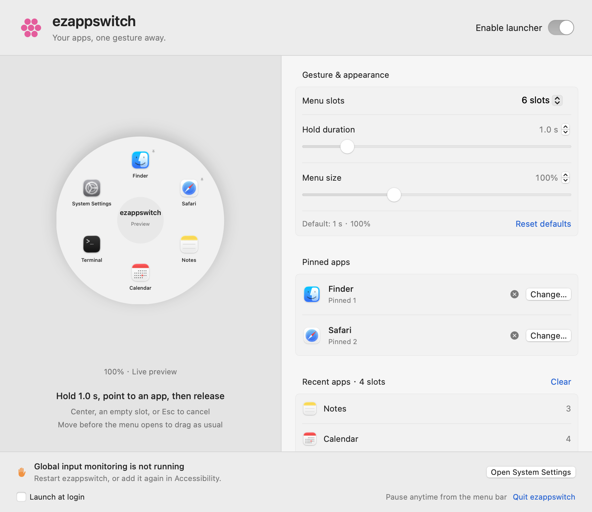
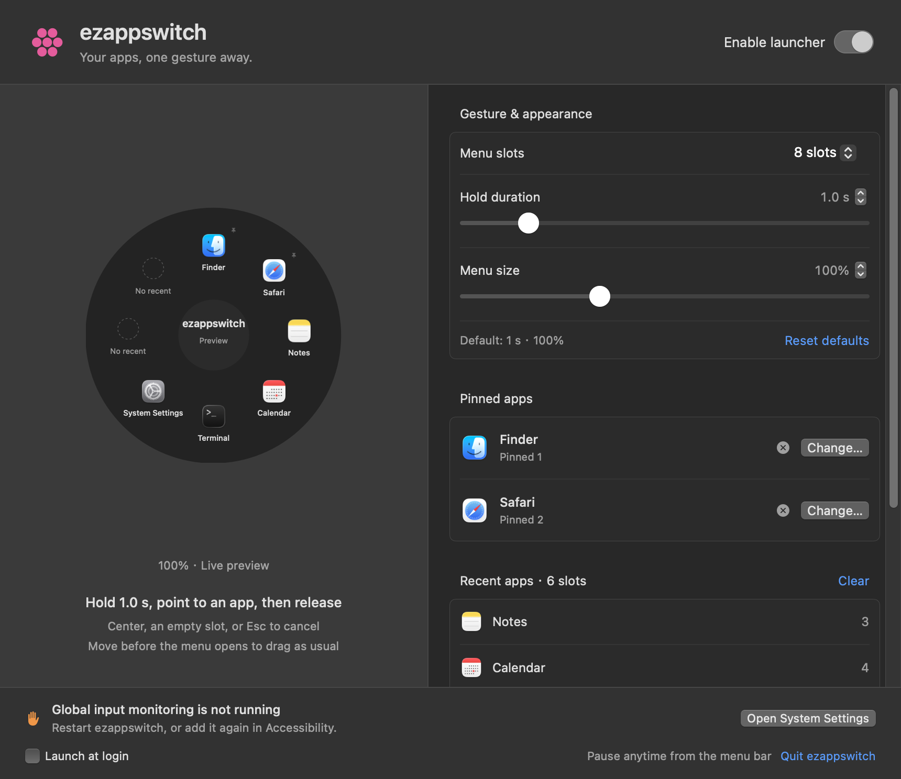

# ezappswitch

A native radial app launcher for macOS. **Hold. Point. Release.**

I built ezappswitch because I got tired of going back to the Dock or digging through Applications just to open an app. It felt like too many small interruptions throughout the day.

With ezappswitch, I hold the left mouse button, move toward an app, and release to open it. I'm sharing this little tool in case someone else finds it useful, too.

**[Download the latest release](https://github.com/greenbug999/ezappswitch/releases/latest)** · [Getting started](#getting-started) · [Build from source](#build-from-source)



## How it works

1. Hold the left mouse button still for **1 second**.
2. A circular menu appears near your pointer.
3. Keep holding, move to an app, and release to open it.

Release in the center or an empty slot, move outside the circle, or press **Esc** to cancel. Move more than 8 points before the menu appears and ezappswitch hands the gesture back as a normal drag.

## Make it yours

| Setting | Default | Options |
| --- | --- | --- |
| Menu slots | 6 | 2–8 |
| Pinned apps | 2 empty slots | Choose your own apps |
| Remaining slots | Recent apps | Updated when an app becomes active |
| Hold duration | 1 second | 0.3–5 seconds |
| Menu size | 100% | 75%–150% |
| Launch at login | Off | Optional |

Pinned apps never appear twice in the recent slots. If there aren't enough recent apps, the extra slots stay empty. Recent apps are tracked only while ezappswitch is running and are saved locally between sessions. The order stays fixed while the menu is open, so an app won't move under your pointer.

The interface uses native macOS frosted-glass materials and follows your light or dark appearance and accent color. Pause or quit anytime from the menu bar.

<details>
<summary>Dark appearance</summary>



</details>

## Getting started

**Requires macOS 13 or later.** The universal download contains Apple Silicon and Intel builds. Runtime checks were performed on Apple Silicon; the Intel build has not been tested on Intel hardware.

1. Download `ezappswitch-1.2.0-macOS-universal.dmg` from [Releases](https://github.com/greenbug999/ezappswitch/releases).
2. Open the disk image and drag **ezappswitch.app** into **Applications**.
3. Open ezappswitch, then select **Open System Settings**.
4. Under **Privacy & Security → Accessibility**, enable ezappswitch. If it isn't listed, add `/Applications/ezappswitch.app` with the **+** button.
5. Return to ezappswitch, choose your two pinned apps, and try a long press.

The release uses a local ad-hoc signature and is **not Apple-notarized**. If macOS blocks it after you try opening it normally, use the app-specific **Open Anyway** option in Privacy & Security. Do not disable Gatekeeper or System Integrity Protection. Your organization may restrict this option.

To upgrade, quit the previous version and replace the app in Applications. Pinned apps, history, and preferences use the same local bundle identifier and are retained. A changed signature may require removing and re-adding ezappswitch in Accessibility.

## Privacy and permissions

ezappswitch does not make network requests or upload app history. Settings and recent apps stay in local macOS preferences under `local.qinghuan.launcher`.

Accessibility access is used to filter the mouse gesture, keep normal clicks and drags working, and prevent a menu selection from clicking through to the app underneath. Recent apps come from macOS application-activation notifications. No screen recording permission is needed by the launcher.

## A few practical limits

- Short clicks are forwarded when the mouse button is released. Drawing tools, games, or gestures that need an immediate mouse-down may work better with ezappswitch paused.
- Modifier-key clicks and ezappswitch's own settings controls keep their native behavior.
- Protected screens, including the lock screen, aren't supported.
- App switches while ezappswitch is closed aren't recorded.
- The system's Reduce Transparency setting can make the material more opaque.

## Build from source

Swift, AppKit, and SwiftUI. No third-party package dependencies.

Install Apple's Command Line Tools or Xcode, then run:

```sh
git clone https://github.com/greenbug999/ezappswitch.git
cd ezappswitch
bash scripts/build.sh
```

This runs the core checks, compiles both Mac architectures, creates the app icon, applies a local ad-hoc signature, and writes the DMG and ZIP to `dist/`. Intermediate files stay in `.artifacts/`.

For a quick development build and core checks:

```sh
swift run OrbitCoreChecks
swift run Orbit --settings
```

The DEBUG-only integration check uses a dedicated test window and isolated preferences. It sends real mouse gestures, temporarily opens Calculator, and restores the previous frontmost app and pointer position:

```sh
swift run Orbit --gesture-check
```

The current release was checked with **155 core assertions** and **16 real-event integration checks**, including custom timing, both size limits, cancellation, normal dragging, and launching an app. macOS permissions are still required on your own machine.

## Feedback

Found a bug or have an idea? [Open an issue](https://github.com/greenbug999/ezappswitch/issues). Include your macOS version, Mac architecture, and a short description of the gesture or behavior.

## License

[MIT](LICENSE). Use it, change it, and share it. Keep the copyright and license notice.
